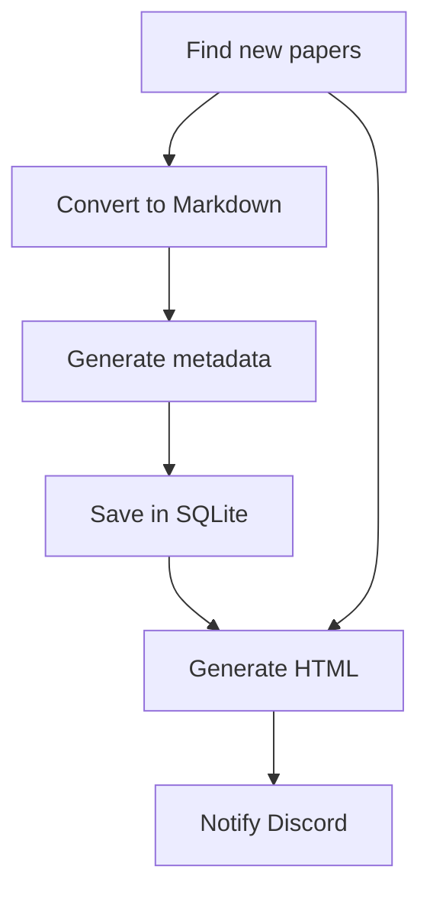

# Assignment 3 - Research Library

We use an Airflow DAG to process research papers placed in a Google Drive folder.
For each new PDF, we extract the text, ask a local LLM for metadata and save the
result in SQLite. We then update an HTML page and send a Discord notification.

The DAG runs daily. Conversion, metadata generation and storage use dynamic task
mapping, so each new paper has its own task instances.



The extra dependency from the first task to HTML generation handles runs with no
new papers. The page can still be updated and pending notifications can be retried.

## Installation

Use Python 3.12 on Linux, macOS or Ubuntu/WSL. Keep the project outside Google
Drive. Run these commands from the project folder:

```bash
uv venv --python 3.12
source .venv/bin/activate
uv pip install -r requirements.lock.txt
cp .env.example .env
```

If you use pip instead of uv, create the environment with `python3.12 -m venv .venv`,
activate it, then run `pip install -r requirements.lock.txt`.
The dependency file contains the versions used for testing, including Airflow 3.1.0,
OpenAI 1.109.0 and PyMuPDF4LLM 2.1.

## Folders and settings

Create a `ResearchLibrary` folder in your Google Drive-synced directory, with
two subfolders: `papers/` for PDFs and `output/` for the generated page.
Make sure the PDFs are available locally.

Fill in the folder path and webhook URL in `.env`. The model settings already
match Ollama. The other settings below are optional; add them if needed.

| Setting | What to put there |
| --- | --- |
| `RESEARCH_LIBRARY_DIR` | The absolute path to your `ResearchLibrary` folder |
| `PAPERS_DB` | A local SQLite path; the default is this project's `data/papers.db` |
| `LOCAL_LLM_BASE_URL` | Your local model server's URL |
| `LOCAL_LLM_MODEL` | The name of the model loaded on that server |
| `DISCORD_WEBHOOK_URL` | The webhook URL for your Discord channel |

The SQLite database must stay outside Google Drive. Airflow has its own database
under `.airflow/`; our `papers.db` only stores paper metadata. Markdown files are
saved next to `papers.db`, in a `markdown/` folder.

On WSL, use the Linux path to your synced folder, for example
`/mnt/g/My Drive/ResearchLibrary` if Drive is mounted there. Google Drive does the
sync itself. The DAG reads and writes local files.

## Local LLM

The default is Ollama with `llama3.2:3b`:

```bash
ollama pull llama3.2:3b
ollama serve
```

If Ollama is already running, leave it running. The default URL is
`http://127.0.0.1:11434/v1/`. The OpenAI Python client sends requests to this local
server.

You can also use LM Studio, as in the practical. Load a model, start **Model Server**,
then set these values in `.env`:

```bash
export LOCAL_LLM_BASE_URL='http://localhost:1234/v1'
export LOCAL_LLM_API_KEY='lm-studio'
export LOCAL_LLM_MODEL='the-model-name-shown-in-LM-Studio'
```

The paper, prompt and answer must fit in the model's context. The code accepts up
to 24,000 characters by default. Start with a context such as 16,384 tokens if your
model supports it, but remember that characters and tokens are different. For a
longer paper, increase both the server's context size and `MAX_PAPER_CHARACTERS`.
The task stops if the text exceeds the limit; it does not cut off the end.

If your server does not support JSON mode, set `LOCAL_LLM_JSON_MODE=0`. The JSON
parsing and single retry still apply. If the server runs on Windows and Airflow
runs in WSL, check that the URL is reachable from WSL; you may need the Windows
host address instead of localhost.

## Run the DAG

Create a webhook in your Discord channel's integration settings and paste the URL
into `.env`. This file is ignored by Git. Keep the webhook out of screenshots too.

```bash
source .venv/bin/activate
source scripts/env.sh
python scripts/check_setup.py
airflow standalone
```

Open `http://localhost:8080` and log in with the details printed by Airflow.
Find `paper_pipeline` and unpause it. It runs daily, but you can trigger it manually
from the UI. After adding a PDF, wait at least 30 seconds before triggering.
This reduces the chance of reading a file while Drive is still copying it.

To trigger it from another terminal:

```bash
source .venv/bin/activate
source scripts/env.sh
airflow dags trigger paper_pipeline
```

Check the result:

1. In the Airflow UI, check that the tasks succeeded.
2. Open `ResearchLibrary/output/index.html`, try the category filter and a PDF link.
3. Run `python scripts/show_database.py` to see the stored metadata.
4. Check the notification in Discord.
5. Run again without adding a PDF. There should be no new row or message.
6. Add a second PDF and run again. Both papers should appear on the page.

Open the HTML file locally. Drive syncs it, but does not serve it as a website.
Keep `papers/` and `output/` next to each other so the PDF links work.

## Retries and assumptions

The filename identifies a paper. An existing filename is skipped, even if the PDF
was edited. We only scan PDFs directly inside `papers/`.

The SQLite insert is idempotent: retrying it does not add a second row for the same
paper. Only one DAG run can be active, and model requests run one at a time.
Other tasks can run in parallel; SQLite waits up to 30 seconds if another task is
writing to the database.

The metadata task has two attempts in total if the JSON is invalid. Other tasks
have one Airflow retry. If a paper fails, the final HTML and Discord tasks wait
until a run has no upstream failures. Fix or remove the failing input and run again.

The `notified` column records which messages were sent. If Discord fails, the
message stays pending and can be sent on the next run, even without a new PDF.
A crash after sending but before updating SQLite can still cause a duplicate.
For an existing database, the new column is added without removing any rows.
Old papers are marked notified so they are not all sent to Discord after the update.

We assume text PDFs and a single machine: all tasks need access to the saved
Markdown files. The 30-second wait helps with copying, but cannot guarantee that
a slow copy has finished.

## Tests

```bash
python -m unittest discover -s tests -v
```

The tests use the task functions, PyMuPDF4LLM, SQLite and the OpenAI client.
A local test server returns fixed JSON and receives the webhook requests.
They cover new papers, retries, duplicate inserts and failed notifications.
Also run the DAG with your actual model and webhook to check the full workflow.
